# Самостійна робота #2 (C# / LeetCode)
 
**Технології:** C#, .NET 10.0  
**Рівень складності:** Medium

## Загальний прогрес (новий Submissions)
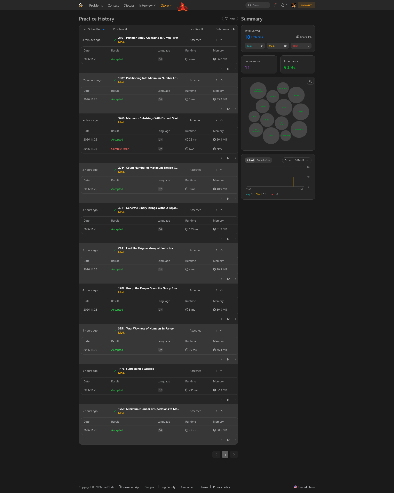

---

## Завдання 1: 1769. Minimum Number of Operations to Move All Balls to Each Box
- **Умова на LeetCode:** [Minimum Number of Operations to Move All Balls to Each Box](https://leetcode.com/problems/minimum-number-of-operations-to-move-all-balls-to-each-box)
- **Код:** [`Task1_MinOperationsToMoveBalls/MinOperationsToMoveBalls.cs`](./Task1_MinOperationsToMoveBalls/MinOperationsToMoveBalls.cs)

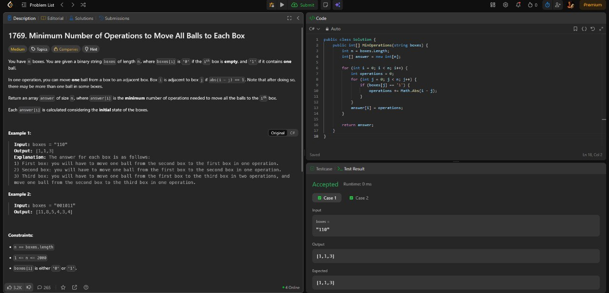

---

## Завдання 2: 1476. Subrectangle Queries
- **Умова на LeetCode:** [Subrectangle Queries](https://leetcode.com/problems/subrectangle-queries/)
- **Код:** [`Task2_SubrectangleQueries/SubrectangleQueries.cs`](./Task2_SubrectangleQueries/SubrectangleQueries.cs)

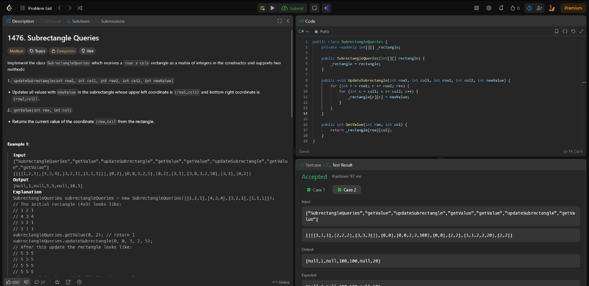

---

## Завдання 3: 3751. Total Waviness of Numbers in Range I
- **Умова на LeetCode:** [Total Waviness of Numbers in Range I](https://leetcode.com/problems/total-waviness-of-numbers-in-range-i/)
- **Код:** [`Task3_TotalWavinessInRangeI/TotalWavinessInRangeI.cs`](./Task3_TotalWavinessInRangeI/TotalWavinessInRangeI.cs)

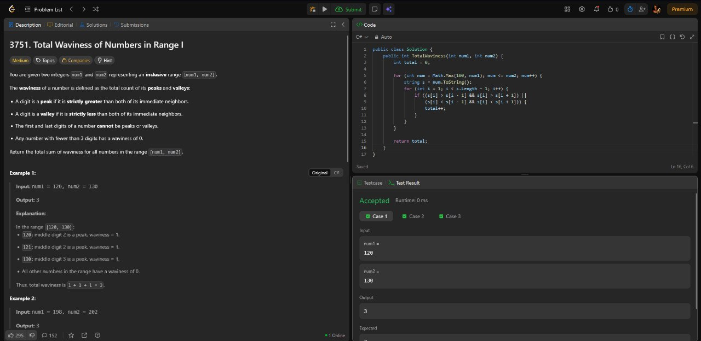

---

## Завдання 4: 1282. Group the People Given the Group Size They Belong To
- **Умова на LeetCode:** [Group the People Given the Group Size They Belong To](https://leetcode.com/problems/group-the-people-given-the-group-size-they-belong-to/)
- **Код:** [`Task4_GroupPeopleBySize/GroupPeopleBySize.cs`](./Task4_GroupPeopleBySize/GroupPeopleBySize.cs)

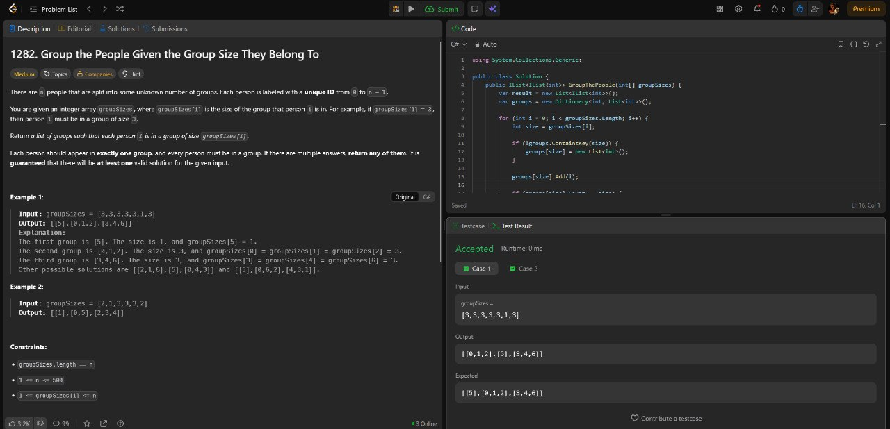

---

## Завдання 5: 2433. Find The Original Array of Prefix Xor
- **Умова на LeetCode:** [Find The Original Array of Prefix Xor](https://leetcode.com/problems/find-the-original-array-of-prefix-xor/)
- **Код:** [`Task5_OriginalArrayOfPrefixXor/OriginalArrayOfPrefixXor.cs`](./Task5_OriginalArrayOfPrefixXor/OriginalArrayOfPrefixXor.cs)

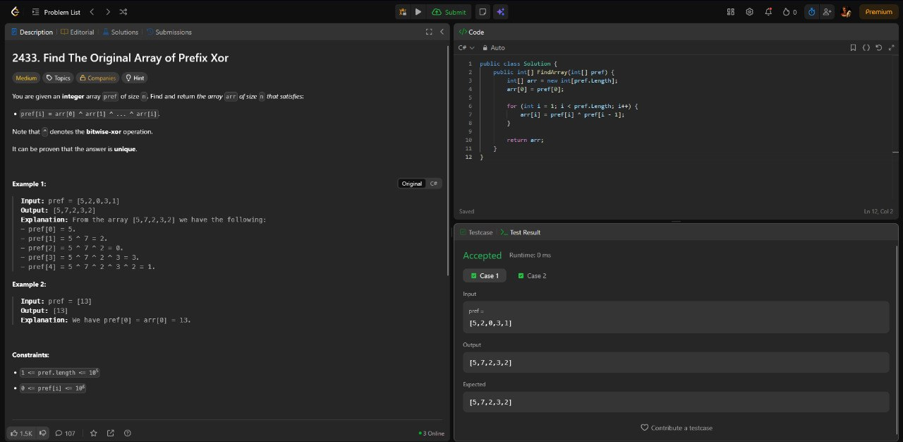

---

## Завдання 6: 3211. Generate Binary Strings Without Adjacent Zeros
- **Умова на LeetCode:** [Generate Binary Strings Without Adjacent Zeros](https://leetcode.com/problems/generate-binary-strings-without-adjacent-zeros/)
- **Код:** [`Task6_BinaryStringsWithoutAdjacentZeros/ValidBinaryStrings.cs`](./Task6_BinaryStringsWithoutAdjacentZeros/ValidBinaryStrings.cs)

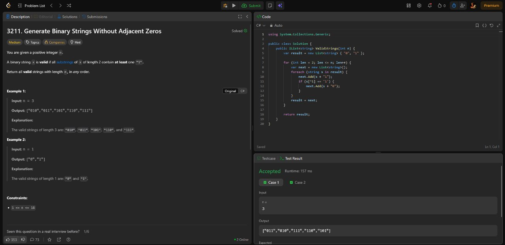

---

## Завдання 7: 2044. Count Number of Maximum Bitwise-OR Subsets
- **Умова на LeetCode:** [Count Number of Maximum Bitwise-OR Subsets](https://leetcode.com/problems/count-number-of-maximum-bitwise-or-subsets)
- **Код:** [`Task7_CountMaxBitwiseOrSubsets/CountMaxBitwiseOrSubsets.cs`](./Task7_CountMaxBitwiseOrSubsets/CountMaxBitwiseOrSubsets.cs)

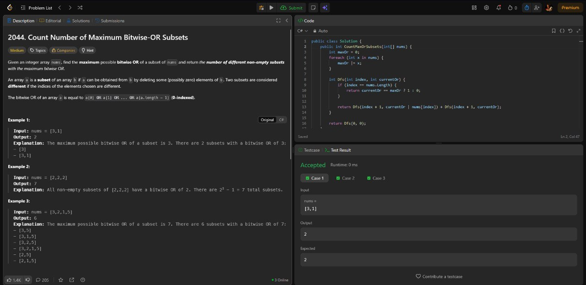

---

## Завдання 8: 3760. Maximum Substrings With Distinct Start
- **Умова на LeetCode:** [Maximum Substrings With Distinct Start](https://leetcode.com/problems/maximum-substrings-with-distinct-start/)
- **Код:** [`Task8_MaxSubstringsWithDistinctStart/MaxSubstringsWithDistinctStart.cs`](./Task8_MaxSubstringsWithDistinctStart/MaxSubstringsWithDistinctStart.cs)

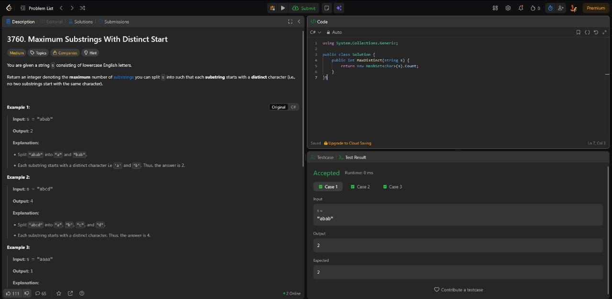

---

## Завдання 9: 1689. Partitioning Into Minimum Number Of Deci-Binary Numbers
- **Умова на LeetCode:** [Partitioning Into Minimum Number Of Deci-Binary Numbers](https://leetcode.com/problems/partitioning-into-minimum-number-of-deci-binary-numbers)
- **Код:** [`Task9_PartitioningIntoMinDeciBinaryNumbers/MinDeciBinaryPartitions.cs`](./Task9_PartitioningIntoMinDeciBinaryNumbers/MinDeciBinaryPartitions.cs)

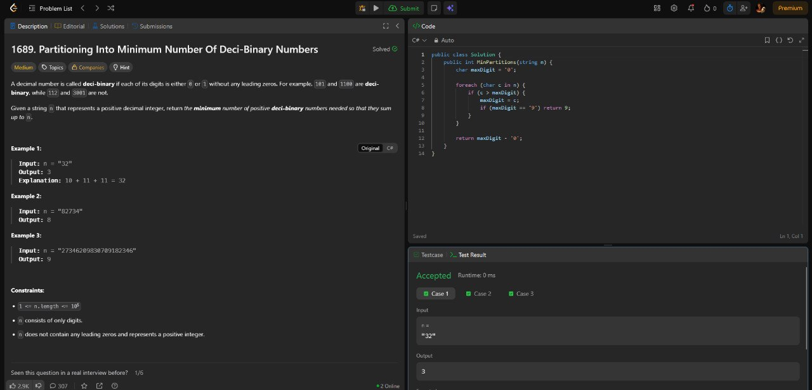

---

## Завдання 10: 2161. Partition Array According to Given Pivot
- **Умова на LeetCode:** [Partition Array According to Given Pivot](https://leetcode.com/problems/partition-array-according-to-given-pivot)
- **Код:** [`Task10_PartitionArrayByPivot/PartitionArrayByPivot.cs`](./Task10_PartitionArrayByPivot/PartitionArrayByPivot.cs)

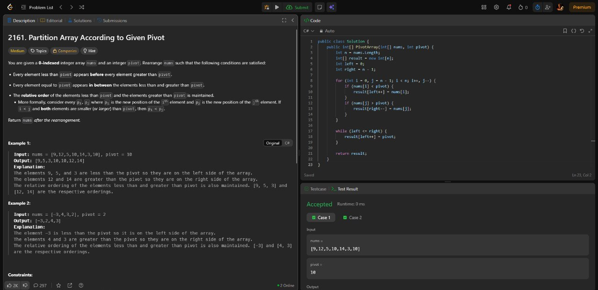